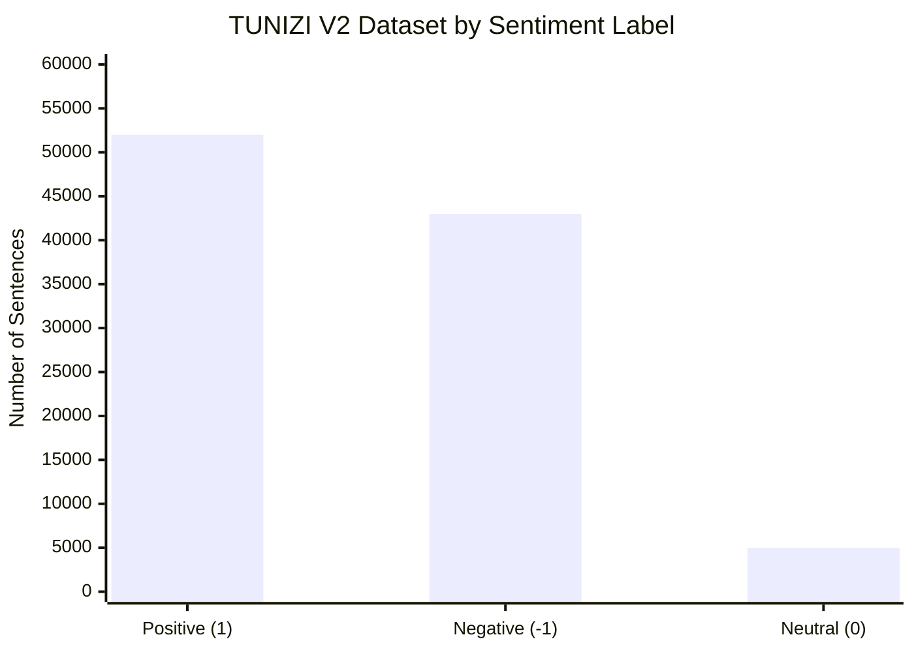

# CompNeuro-Final-Project

## Data Description and Visualization:

The dataset used for this project was TUNIZI V2, the largest Tunisian Arabizi dataset including 100,000 sentences, 52% annotated as positive (1), 43% as negative (-1), and 5% as neutral (0). This CommonCrawl-based dataset was extracted from social media and the chosen posts included sports, politics, comedy, TV shows, TV series, arts and Tunisian music videos, such that the dataset is representative and contains a variety of ages, backgrounds, and writing.

"Tunizi" is the Tunisian Arabic dialect of Arabizi, a romanization of Arabic text. Arabizi dialects and variants are undermodeled - although some fine-tuned BERT sentiment analysis models exist for Moroccan Arabizi and Modern Standard Arabic Arabizi, many other dialects have not been modeled. Sentiment analysis models for Tunizi and other Arabizi dialects are important as Arabic romanization is used frequently in social media posts and comments from Middle Eastern countries. By creating models that can more accurately process Arabizi, other projects assessing social media sentiment from Middle Eastern countries may be expanded, or their accuracy improved when compared to past projects that threw out Arabizi content or used models not fine-tuned to process it.

In this project, preprocessing was completed using the mBERT and AraBERT models' internal functionality. Since the dataset was already cleaned for mBERT processing, more cleaning was not necessary.

* Source Paper for TUNIZI V2: https://www.aclweb.org/anthology/2021.wanlp-1.25.pdf
* Modern Standart Arabizi model, BAERT: https://aclanthology.org/2020.coling-main.51.pdf
* Moroccan Darija Arabizi model: https://www.semanticscholar.org/paper/Sentiment-Analysis-of-Moroccan-Darija-Arabizi%3A-A-of/13d7777bf1d948f04533dc15d813fa807dd40869

## Objective:

The objective of this project is to compare the performance of AraBERT, an Arabic sentiment analysis model, to the performance of mBERT, a multilingual sentiment analysis model, when fine-tuned to process Tunisian Arabizi tweets.

## Model Description: 

AraBERT is a transformer-based model pre-trained on massive corpora of Arabic text. AraBERT is based on the BERT model, a stacked Bidirectional Transformer Encoder. BERT models' pre-training is bidirectional, meaning that words are understood within the context of preceeding and following words in a sentence. The pre-training relies on masked language models that mask a word in a sentence and force the BERT model to infer what it is based on the context to its right and left in a sentence. Encoders in the model translate input data into representations that are easier to process while transformers use encoder representations to infer patterns or make predictions. The AraBERT model was chosen for the project because Tunisian Arabic is an Arabic dialect and the model may process Arabic-based text better then a multilingual model. Yet, this model was pre-trained on the Arabic script, and did not encounter Latin script in training.

mBERT is a transformer-based model pre-trained on large multilingual corpora in a self-supervised fashion. mBERT is also based on the BERT model. This model was chosen because it was pre-trained on a wide variety of scripts and languages, and therefore may perform better for sentiment analysis.

## Metrics: 

The assessment metrics for this project include precision, recall, accuracy, the confusion matrix and particularly the weighted F1 Score for each model during validation as the TUNIZI dataset is not balanced. The weighted F1 score is computed using the F1 score (calculated using precision and recall) for each class, which is averaged based on its support, or the number of actual occurances of the class in the dataset.

### Confusion Matrix for mBERT

| Actual \ Predicted | Negative (0) | Neutral (1) | Positive (2) |
|--------------------|--------------|-------------|--------------|
| **Negative (0)**   | 2131         | 31          | 448          |
| **Neutral (1)**    | 89           | 42          | 82           |
| **Positive (2)**   | 500          | 22          | 2655        |

### Classification Report for mBERT

| Sentiment | Precision | Recall | F1-Score | Support |
|-----------|-----------|--------|----------|---------|
| Negative  | 0.78 | 0.82 | 0.80 | 2610 |
| Neutral   | 0.44 | 0.20 | 0.27 | 213 |
| Positive  | 0.83 | 0.84 | 0.83 | 3177 |
| **Accuracy** | | | **0.80** | **6000** |
| **Macro Avg** | 0.69 | 0.62 | 0.64 | 6000 |
| **Weighted Avg** | **0.80** | **0.80** | **0.80** | **6000** |

### Confusion Matrix for AraBERT

| Actual \ Predicted | Negative (0) | Neutral (1) | Positive (2) |
|--------------------|--------------|-------------|--------------|
| **Negative (0)**   | 1919         | 22           | 669          |
| **Neutral (1)**    | 83           | 35           | 95           |
| **Positive (2)**   | 374          | 14           | 2789         |

### Classification Report

| Sentiment | Precision | Recall | F1-Score | Support |
|-----------|-----------|--------|----------|---------|
| Negative  | 0.81 | 0.74 | 0.77 | 2610 |
| Neutral   | 0.49 | 0.16 | 0.25 | 213 |
| Positive  | 0.78 | 0.88 | 0.83 | 3177 |
| **Accuracy** | | | **0.79** | **6000** |
| **Macro Avg** | 0.70 | 0.59 | 0.62 | 6000 |
| **Weighted Avg** | **0.78** | **0.79** | **0.78** | **6000** |

## Interpretation/Discussion:
The weighted F1 score for mBERT was 0.80, while for AraBERT it was 0.78. mBERT outperformed AraBERT in accuracy (0.80 vs 0.79), weighted precision (0.80 vs 0.78), weighted recall (0.80 vs 0.79), weighted F1 (0.80 vs 0.78), and macro F1 (0.64 vs 0.62). mBERT correctly predicted more negative sentiment examples while AraBERT correctly predicted more positive examples. Both models performed poorly when assessing neutral sentiment examples.

The results for each model are fairly similar, but the metrics showed mBERT typically outperformed AraBERT in the given Tunizi sentiment analysis tasks. This is likely due to the fact that mBERT was trained on a variety of languages, and particularly a variety of scripts. AraBERT's pre-training on Arabic-specific data did not give it a significant advantage over mBERT, and likely disadvantaged the model was it was trained only on Arabic script. 

The most significant result of this project was the poor performance of each model on neutral sentiment examples. This phenomenon can likely be contributed to the relatively small neutral category, or perhaps some ambiguity in the neutral Tunisian sentences or their annotation process. Another cause may be that the two models were pre-trained on five sentiment categories (very negative, negative, neutral, positive, very positive), instead of three (negative, neutral, positive). 

Limitations of this project include that neither model is pre-trained on tweets, Tunisian Arabic, or Arabizi specifically. Additionally, computational power and time limits restricted the training dataset, and the dataset itself had only 100,000 sentences, and the sentences were sometimes very short. One limitation for expanding the project is that another dataset for Tunisian Arabizi would be hard to find for further training or analysis. Finally, the usage for a fine-tuned Tunisian Arabizi model based on this dataset is quite particular, as it would only be only useful to analyze sentiment in Tunisian Arabizi social media data.
